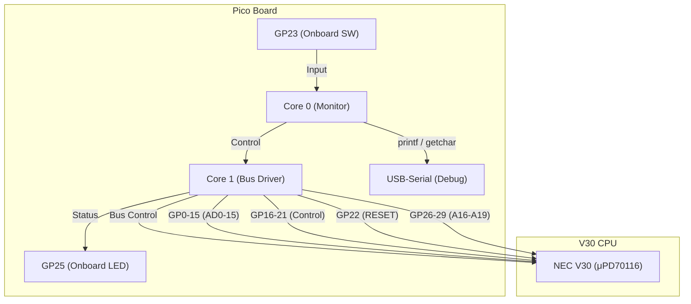

# Raspberry Pi Pico & NEC V30 接続プロジェクト

## 概要
このドキュメントは、Raspberry Pi Pico互換機（RP2040ベース）を使用して、NEC V30 (μPD70116) または 80C88 (8088) CPUを3.3Vで駆動させる最小構成システムのハードウェア接続方法をまとめたものです。

Picoのデュアルコアを活用し、Core 1がCPUのバスをエミュレートし、Core 0がPC（またはAndroid ChromeのWebUSB端末 `docs/index.html`）とのUSBシリアル通信やモニタプログラムを担当します。

## ハードウェア構成
- **CPU**: NEC V30 (μPD70116) / 80C88 (8088) — **同一基板で差し替え対応**
  - リセット直後の最初の T1 (`FFFF0h` フェッチ) でデータバスを Hi-Z のまま GP19 (Pin 28: V30=`M/IO#` HIGH / 80C88=`IO/M#` LOW) を読み、自動で判定します。
  - 80C88 時は GP0-7 (AD0-7) のみドライブし、A8-15 (GP8-15) は常時入力 (Hi-Z) を維持します。
- **コントローラ**: Raspberry Pi Pico互換機 (GP0-22, 24, 26-29が使用可能なボード)
- **ロジック電圧**: **3.3V**
    - V30のVCC(40ピン)にPicoの3.3Vを供給することで、レベルシフタが不要になります。

### ブロック図


## ピン接続
### V30 - Pico 接続テーブル
V30の全40ピンの接続先一覧です。PicoのGPIOは、プログラミングのしやすさを考慮して連続したブロックに割り当てています。

| グループ            | Pico GPIO | V30 Pin  | V30ピン名  | 方向 (Pico) | 役割・備考                              |
|---------------------|-----------|----------|------------|-------------|-----------------------------------------|
| **データ/アドレス** | GP0-15    | (下記)   | AD0 - AD15 | In/Out      | バスライン。330Ωの短絡保護抵抗を推奨。 |
| **制御信号**        | GP16      | 25       | ALE        | In          | アドレスラッチ信号                      |
|                     | GP17      | 32       | `RD`       | In          | 読み込み信号                            |
|                     | GP18      | 29       | `WR`       | In          | 書き込み信号                            |
|                     | GP19      | 28       | IO/`M`     | In          | メモリ/IO選択                           |
|                     | GP20      | 34       | `BHE`      | In          | バスハイイネーブル                      |
| **クロック**        | GP21      | 19       | CLK        | Out         | PicoからV30へクロックを供給             |
| **リセット**        | GP22      | 21       | RESET      | Out         | V30のリセット制御用                     |
| **オンボードSW**    | GP23      | (基板上) | User SW    | In          | ソフトウェアリセットのトリガー等に使用  |
| **予備**            | GP24      | -        | -          | -           | 将来の拡張用 (空き)                     |
| **オンボードLED**   | GP25      | (基板上) | User LED   | Out         | バスアクセスやステータス表示に使用      |
| **上位アドレス**    | GP26      | 38       | A16/S3     | In          | アドレス拡張                            |
|                     | GP27      | 37       | A17/S4     | In          |                                         |
|                     | GP28      | 36       | A18/S5     | In          |                                         |
|                     | GP29      | 35       | A19/S6     | In          | リセットベクタ `FFFF0h` の検知に利用    |

*ADバス詳細:*
- `AD0..AD7` (V30 Pins 16..9) -> `Pico GP0..GP7`
- `AD8..AD15` (V30 Pins 8..2, 39) -> `Pico GP8..GP15`

### V30 固定ピン接続
以下のV30ピンは、Picoに接続せず、VCC(3.3V)またはGNDに直接接続します。

| V30 Pin | V30ピン名 | 接続先       | 理由                                       |
| ------- | --------- | ------------ | ------------------------------------------ |
| 40      | VCC       | **3.3V**     | V30を3.3Vで駆動するため                    |
| 1, 20   | GND       | **GND**      | 接地                                       |
| 33      | MN/`MX`   | **3.3V**     | ミニマムモードで動作させるため             |
| 22      | READY     | **3.3V**     | ウェイトステートを発生させないため         |
| 23      | `TEST`    | **GND**      | `WAIT`命令によるCPUフリーズを回避するため  |
| 17      | NMI       | **GND**      | 割り込みを使用しないため                   |
| 18      | INTR      | **GND**      | 割り込みを使用しないため                   |
| 31      | HOLD      | **GND**      | DMAを使用しないため                        |
| 24      | `INTA`    | Open (未接続)| 割り込みを使用しないため                   |
| 26      | `DEN`     | Open (未接続)| Picoが直接バスを制御するため不要           |
| 27      | DT/`R`    | Open (未接続)| Picoが`RD`/`WR`で方向を判断するため不要    |
| 30      | HLDA      | Open (未接続)| DMAを使用しないため                        |


## 短絡保護について
V30を3.3Vで駆動するため電圧変換は不要ですが、開発中のプログラムのバグ等でPicoとV30が同時にバスに出力（バス衝突）する可能性があります。
これを防ぎチップを保護するため、**AD0-AD15の各バスラインに330Ω程度の抵抗を直列に挿入する**ことを強く推奨します。

```
V30 (ADx)  ----[ 330Ω ]---- Pico (GPx)
```

## モニタプログラム仕様
PicoのCore 0上で動作するモニタプログラムのコマンド一覧です。USBシリアルコンソール経由で操作します。

| コマンド   | 引数               | 説明                                                                       |
|------------|--------------------|----------------------------------------------------------------------------|
| `?`        | -                  | ヘルプメッセージを表示します。                                             |
| `d`        | `<addr> [len]`     | 指定アドレスからメモリ内容をダンプします。`len`はデフォルト256バイトです。 |
| `e`        | `<addr> <val>...`  | 指定アドレスのメモリを16進数の値で書き換えます。                           |
| `l`        | `<addr> [len]`     | 指定アドレスから逆アセンブルします。（現在未実装）                         |
| `r`        | -                  | V30を実行し、バスのログを取得します（最大5000サイクル）。                   |
| `g`        | -                  | V30をログなしで連続実行します。任意のキーを押すと停止します。              |
| `c`        | -                  | 現在のクロック設定と使い方を表示します。                                     |
| `c g`      | `[addr_ns] [low_ns] [high_ns]` | GPIOクロック (既定)。Core 1がバス処理と同期してCLKを生成します。T1でアドレスを読むまでのLow幅、Low幅、High幅の最小値を指定 (省略時 V30: `72 52 40` / 80C88: `80 60 60`)。HIDOSモードのアセンブラ版エンジンはちょうどこの幅で、ログモードのC版は処理時間が加算されます。 |
| `c p`      | `[phase] [loops]` | HIDOSエンジンの各フェーズの待ちループ数を個別に上書き・表示します (チューニング用、`c g`で再計算)。 |
| `c s`      | `<MHz>` | Picoのシステムクロック (既定250)。250超はコア電圧1.30V (オーバークロック)。HIDOSモードではCPU側が律速なのでほぼ速くなりません。 |
| `c`        | `<kHz>`            | PWMクロック (従来方式)。固定周波数で、Core 1はバスをポーリングします。       |
| `cpu`      | `[auto\|v30\|8088]` | CPU種別の自動判別・表示、または手動固定を行います。                         |
| `xr`       | -                  | XMODEM(CRC)でPicoのRAMにバイナリを書き込みます。                           |
| `xs`       | -                  | PicoのRAM内容をXMODEM(CRC)で送信します。                                   |
| `xl`       | -                  | `r`コマンドで取得したバスログをXMODEM(CRC)で送信します。                     |
| `v`        | -                  | モニタのバージョンとRAMサイズを表示します。                                  |
| `autotest` | -                  | `xr` -> `r` -> `xl` を一括で実行する自動テスト機能です。                   |
| `k`        | -                  | 組み込みの boot.img をRAMにロードします。                                    |
| `h`        | `[loglevel]`       | HIDOS VMをバックグラウンドで起動します。モニタはそのまま使えます。           |
| `s`        | -                  | HIDOS VMを停止します。                                                       |
| `b`        | -                  | BOOTSELモードで再起動します (モニタポートを1200bpsで開いても同じ)。         |

実行後は終了理由、バスサイクル数、GPIOクロック時は実効クロック周波数 (avg kHz) を表示します。

### USBシリアルポート
USBは4つのCDCシリアルポートとして見えます (Linuxでは `/dev/serial/by-id/usb-cradle86_cradle86_V30_<serial>-ifNN`)。

| ポート | interface | 用途 |
|--------|-----------|------|
| 0 | if00 | モニタ (このコマンド表) |
| 1 | if02 | HIDOS DOS画面 (CONデバイス) |
| 2 | if04 | HIDOS AUX (COM) |
| 3 | if06 | 仮想ディスク。`disk_server.py` (`make disk-server`、既定は空の `b.img` を作成) がPC上のイメージファイルを B: として読み書きさせます。イメージの代わりにディレクトリを指定すると(`make disk-server DISK_IMG=~/dosfiles`)、その中身が B: に見え、DOS での書き換えがPC上のファイルに反映されます(PC側の変更はディスク交換として DOS に通知)。A: は常にフラッシュ内の disk.img (読み込み専用)。サーバ未起動時の B: はノットレディになります。 |

DOS上で `SANITY` を実行すると、CPU種別判別(V30/V20/8086/8088)・命令・メモリ・時計・AUX・A:・B: をまとめて確認します (`embedded-hidos/sanity.asm`)。B: はサーバ未起動ならSKIPします。終了コードは失敗したテストの数です。また `MANDEL` (マンデルブロ集合描画＋所要時間計測) と `LIFE` (ライフゲーム・グライダー銃) も A: に収録されています。

ブラウザ端末 (`docs/index.html`) を HTTPS で開くと、Android Chrome では WebUSB でポート 0 (モニタ)・ポート 1 (DOS画面)・ポート 3 (ブラウザ内 1MB FAT12 仮想ディスク B:) を同時に開けます（PC Chrome/Edge では Web Serial で接続）。
